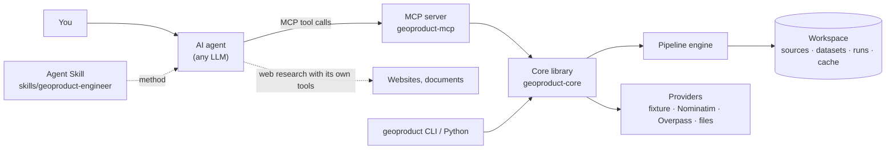

# GeoProduct Engineer

[](https://github.com/Ppp2048/geoproduct-engineer-skill/actions/workflows/ci.yml)

An open-source toolkit that helps AI agents research, build, check and deliver geographic datasets in which every location and attribute can be traced to its evidence.

It has three parts that work together or alone:

- **an Agent Skill** that teaches an agent the method;
- **an MCP server** that gives the agent tools to do the work;
- **a pipeline engine** that runs the work as repeatable, resumable stages.

> **Status: pre-release (`0.1.0.dev0`).** Tested locally on Windows with Python 3.14, and by CI on Python 3.12 to 3.14 on Linux, macOS and Windows. The badge above shows the latest CI result. The packages are not on PyPI yet, so run them from a clone (below). The interfaces may still change before 1.0.

## The problem

Ask an agent for "every hospital in this district, with its building" and you usually get a plausible list. Some coordinates are geocoded guesses. Some building links are assumptions, and some attributes come from nowhere in particular. Nothing tells you which is which.

GeoProduct Engineer makes that difference explicit and checkable:

- **Evidence.** Each value records whether it is a sourced fact, an estimate or an inference, and which source supports it.
- **Location.** Each location says how it was obtained (address point, building footprint, centroid, approximate) and how precise it is.
- **Building matches.** Each match is `exact`, `probable`, `ambiguous`, `approximate_point` or `none`, with the reasons. An uncertain match is never shown as a certain one.
- **Conflicts.** When sources disagree, both values are kept side by side.
- **Unresolved records.** A record that cannot be resolved is marked unresolved, with the reason, instead of being filled in.
- **Quality report.** Every dataset comes with a report: a quality score, check results, findings, and the licences and attribution it inherits from its sources.

The toolkit does not invent coordinates, sources, building links or missing values, and it is built so that an agent using it cannot either.

## How it fits together



**Why the skill and the server are separate.**
- The skill is knowledge: how to plan the research, judge sources, match buildings, express uncertainty and report. It works with any agent that reads Agent Skills, and it stays useful as a method even with no server attached.
- The server is capability: tools that collect, compute, validate and export, usable by any MCP client, with or without the skill.
- The core library has no MCP or LLM dependency at all.

Keeping them apart means each can be installed, versioned and replaced on its own.

**Who does what.**
- The agent does the research: finding sources, reading them, rating their reliability.
- The server records what the agent supplies and checks it. For example, an evidence excerpt is checked against the fetched page text.
- The server never runs code the agent wrote. Pipelines are built only from registered stages.

## What it can do

- **Sources.**
  - Register the sources the agent found, with ratings and a computed reliability score.
  - Fetch them within limits: public addresses only, `robots.txt`, size and time caps.
  - Keep their text so evidence excerpts can be checked.
- **Collection.**
  - Geocode and reverse geocode.
  - Query OpenStreetMap features with structured tag filters (no raw Overpass QL) and building footprints.
  - Import CSV, GeoJSON or JSON files.
- **Preparation.**
  - Normalise records.
  - Merge duplicates, keeping disagreeing values as conflicts.
  - Geocode records that have no location. Public Nominatim is capped at 100 lookups per run.
- **Building matching.** By containment and proximity, with name and address agreement. Every match states its status, method, score, reasons and candidates.
- **Enrichment.** Count nearby features, find the polygons a record falls in, measure area, length and perimeter.
- **Quality.**
  - Per-record confidence with reasons.
  - Dataset validation: coordinates, CRS, geometry, duplicates, area, outliers, evidence, conflicts and spatial rules.
  - Quality gates.
  - A Markdown and JSON quality report.
- **Export.** RFC 7946 GeoJSON and UTF-8 CSV, with a manifest that holds counts, bounds, licences and file hashes. A GeoJSON export reloads without loss.
- **Pipelines.**
  - Declarative YAML or JSON specs built from 18 registered stages.
  - The whole spec is checked in one pass.
  - Runs in the background, with progress and cancellation.
  - Checkpoints per stage: a failed or cancelled run resumes where it stopped, even with corrected parameters.

The MCP server has 21 tools, 2 prompts (`plan_geographic_dataset`, `audit_dataset_quality`) and read-only resources: a methodology guide, the stage registry, provider status, JSON Schemas, runs and datasets.

## Quick start

You need [uv](https://docs.astral.sh/uv/) and Git. uv installs a suitable Python (3.12 or newer) if you don't have one. No account or key is needed, and the example pipeline runs offline.

```bash
git clone https://github.com/Ppp2048/geoproduct-engineer-skill.git
cd geoproduct-engineer-skill
uv sync
uv run geoproduct run examples/pipelines/hospitals.yaml
```

This runs a ten-stage pipeline against **Sample Town**, a synthetic town built into the offline `fixture` provider. It is not a real place, and every result says so. The run:

1. collects hospitals and clinics;
2. merges a duplicate whose bed counts disagree, keeping both values;
3. matches building footprints: one exact, one probable, one ambiguous, one with none;
4. scores confidence;
5. validates and gates the result;
6. writes a quality report and a GeoJSON export.

The output is in `.geoproduct/runs/<run_id>/stages/`, with one folder per stage. The quality report is in `report/` and the GeoJSON in `geojson/`. The other examples are in [examples/](examples/README.md).

## Installation

### MCP server

Point your MCP client at the server in your clone. For Claude Desktop, Cursor and other clients that use an `mcpServers` block:

```json
{
  "mcpServers": {
    "geoproduct": {
      "command": "uv",
      "args": ["run", "--directory", "/path/to/geoproduct-engineer-skill", "geoproduct-mcp"],
      "env": {
        "GEOPRODUCT_WORKSPACE": "/path/to/my-research/.geoproduct",
        "GEOPRODUCT_USER_AGENT": "my-research/0.1 (you@example.org)"
      }
    }
  }
}
```

For Claude Code:

```bash
claude mcp add geoproduct -e GEOPRODUCT_USER_AGENT="my-research/0.1 (you@example.org)" -e GEOPRODUCT_WORKSPACE=/path/to/my-research/.geoproduct -- uv run --directory /path/to/geoproduct-engineer-skill geoproduct-mcp
```

Once the packages are published, `uvx geoproduct-mcp` will replace `uv run --directory …`.

### Agent Skill

Copy the skill's folder, keeping its name, to where your agent looks for skills. For Claude Code, that is `~/.claude/skills/` for every project, or `.claude/skills/` inside one project:

```bash
cp -r skills/geoproduct-engineer ~/.claude/skills/
```

The skill is self-contained, and its two helper scripts need only the Python standard library. Without the server it still guides the method, and it says which steps it could not carry out.

### Configuration

Everything is set through environment variables, and none of them holds a secret:

| Variable | Purpose |
|---|---|
| `GEOPRODUCT_WORKSPACE` | Where sources, datasets, runs and the cache are kept. Use an absolute path for MCP clients. |
| `GEOPRODUCT_ALLOWED_DIRS` | Other folders the tools may read from and export to. Every other path is refused. |
| `GEOPRODUCT_USER_AGENT` | Identifies you to the public OpenStreetMap services. It is required for them; include a way to reach you. |
| `GEOPRODUCT_NOMINATIM_URL`, `GEOPRODUCT_OVERPASS_URL` | Use a self-hosted or other instance |

[docs/configuration.md](docs/configuration.md) lists every variable and option, the HTTP transport, what the server can reach and the workspace layout.

## Example workflows

**With an agent.** Install the skill and the server, then ask in plain language. For example: *"Build a dataset of the libraries in this town, with opening hours where a source states them, matched to their buildings."* The skill leads the agent through these steps:

1. Plan the dataset and the area.
2. Find and rate sources, and register them.
3. Collect records with their evidence.
4. Geocode, deduplicate and match buildings.
5. Validate the dataset and report on it.
6. Export it.

The agent asks for your confirmation before more than 25 requests to an external service. The skill has workflows for:

- geographic research and source discovery;
- dataset creation and entity resolution;
- building matching and spatial analysis;
- infrastructure research;
- map accuracy audits;
- quality assurance;
- pipeline construction;
- map integration.

**With the CLI.** The four example pipelines run offline:

| Pipeline | Shows |
|---|---|
| [`hospitals.yaml`](examples/pipelines/hospitals.yaml) | Duplicates with conflicting values, building matches of every status, a quality gate |
| [`commercial-buildings.yaml`](examples/pipelines/commercial-buildings.yaml) | Several queries combined, footprints in place of points, floor area, district lookup, CSV and GeoJSON |
| [`transport.yaml`](examples/pipelines/transport.yaml) | Spatial rules: a stop far from any street is caught; a failing gate fixed by resuming with a new parameter |
| [`csv-enrich.yaml`](examples/pipelines/csv-enrich.yaml) | A user CSV geocoded, with a bad row rejected and an unknown address left unresolved, with the reason |

```bash
uv run geoproduct plan examples/pipelines/transport.yaml
uv run geoproduct run examples/pipelines/transport.yaml --param max_stop_distance_m=5   # fails at the gate
uv run geoproduct resume RUN_ID --param max_stop_distance_m=30                          # reruns only what changed
```

To use real data, override the `provider` and `area` parameters (for example `--param provider=overpass`) and set `GEOPRODUCT_USER_AGENT`.

## How the pipeline engine works

A pipeline is a YAML or JSON spec: a list of stages, each naming a registered stage type, its input and its options. Parameters let one spec serve many areas.

```yaml
apiVersion: geoproduct/v1
kind: Pipeline
name: clinics
params:
  area: {bbox: [0.0015, 0.0015, 0.0097, 0.0097]}
stages:
  - id: clinics
    uses: collect.features
    with: {provider: fixture, area: {param: area}, tags: {amenity: clinic}}
  - id: buildings
    uses: collect.buildings
    with: {provider: fixture, area: {param: area}}
  - id: matched
    uses: match.buildings
    input: clinics
    with: {buildings: {stage: buildings}}
  - id: export
    uses: export.geojson
    input: matched
    with: {name: clinics}
```

- **Checking.** The whole spec is checked before anything runs: unknown stages (with suggestions), inputs, option types, and the kinds of data passed between stages. Every problem is listed at once.
- **Checkpoints.** Each stage's output is saved with a fingerprint of its type, version, options and inputs. Resuming skips every stage whose fingerprint still matches, so changing one option reruns only that stage and what follows it.
- **Failures.** Retry-safe stages retry rate limits, outages and timeouts with backoff, honouring `Retry-After`. Invalid records are set aside with reasons rather than failing the run, up to a limit. Ctrl+C, cancellation and crashes leave a resumable run.
- **Provenance.** A run records the spec, library versions, provider endpoints and data timestamps, and each stage's request count and cache hits. With the same provider data, a run gives the same output.

[docs/architecture.md](docs/architecture.md) covers the data contracts, matching rules, engine and server in detail.

## Providers and data licences

| Provider | Gives | Needs | Data licence |
|---|---|---|---|
| `fixture` | Everything, offline, over the synthetic Sample Town | Nothing | CC0 (synthetic) |
| `nominatim` | Geocoding and reverse geocoding | `GEOPRODUCT_USER_AGENT` for the public instance | ODbL 1.0 |
| `overpass` | OpenStreetMap features and building footprints | `GEOPRODUCT_USER_AGENT` for the public instance | ODbL 1.0 |
| Files | Your own CSV, GeoJSON or JSON | An allowed folder | Whatever you state |
| Web sources | Evidence the agent finds and fetches | Public addresses only | Each source's own terms |

**The public OpenStreetMap services are shared and free.** The providers respect their policies:
- one request per second to Nominatim, and at most 100 geocodes per run;
- one Overpass query at a time;
- an identifying User-Agent, and caching.

For volume, point the providers at your own instance.

**Your datasets carry their sources' licences, not this project's.** Data from OpenStreetMap is under the ODbL, and publishing a dataset derived from it brings attribution and share-alike duties. Every export lists the licences and attribution of the sources it uses, so you can meet them. See [OpenStreetMap's copyright page](https://www.openstreetmap.org/copyright).

## Limitations

- **Pre-release.** Not on PyPI yet, and interfaces may change before 1.0.
- **Live services.**
  - Live Nominatim has been tested against the public service.
  - Live Overpass has been tested only against service-shaped mock responses; the opt-in live tests have not yet reached the public service.
  - Public instances are rate-limited and can be slow or unavailable.
- **Providers.** Only OpenStreetMap services are built in. Overture Maps and commercial providers are not, and nothing loads third-party provider plug-ins yet.
- **Exports.** GeoJSON and CSV only.
- **Research.** PDF text is not extracted, so evidence excerpts from PDFs remain `not_checked`. The server does not search the web: the agent researches with its own tools, and the server records and checks what it supplies.
- **Single user.** The HTTP transport has no authentication, so it serves only loopback addresses. One workspace belongs to one user. The guard against running a run twice works within one process only.
- **Scale.** Datasets are held in memory, and a stage may output at most 100,000 records by default. That suits datasets of thousands to tens of thousands of records.
- **Testing.** The skill has been evaluated on a few cases, which did not yet separate it from a capable agent without it.

## Roadmap

These are directions, not promises:

- publish `geoproduct-core` and `geoproduct-mcp` to PyPI;
- an Overture Maps provider for buildings and places, always limited to an area;
- GeoPackage and GeoParquet export;
- PDF text extraction for evidence checks;
- harder skill evaluations, including cases that tempt invention, licence traps and conflicting sources;
- a provider plug-in interface.

## Documentation

| Document | Contents |
|---|---|
| [docs/architecture.md](docs/architecture.md) | Components, data contracts, engine, matching rules, providers, MCP server, security, testing |
| [docs/configuration.md](docs/configuration.md) | Running the server, environment variables, client setup, skill installation |
| [docs/decisions.md](docs/decisions.md) | Build stages and the decisions taken, with reasons |
| [docs/research.md](docs/research.md) | The research behind the design: related projects, libraries, providers and licensing |
| [docs/releasing.md](docs/releasing.md) | Versioning and the release checklist |
| [examples/](examples/README.md) | The example pipelines |
| [skills/geoproduct-engineer/](skills/geoproduct-engineer/SKILL.md) | The Agent Skill |
| [CHANGELOG.md](CHANGELOG.md) | Changes by version |

## Contributing

Contributions are welcome. [CONTRIBUTING.md](CONTRIBUTING.md) explains the development setup, the checks a change must pass and the project's ground rules, such as never inventing data and tests that need no network. To report a vulnerability, see [SECURITY.md](SECURITY.md).

## Licence

The code is licensed under the [Apache License 2.0](LICENSE). See [NOTICE](NOTICE). Data you collect or produce with it is covered by its sources' licences, as described above.
