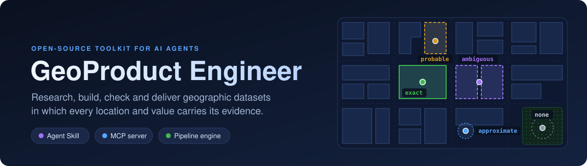
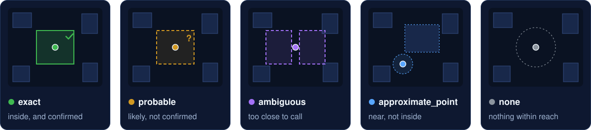
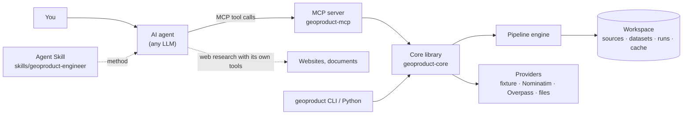
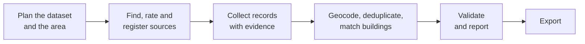
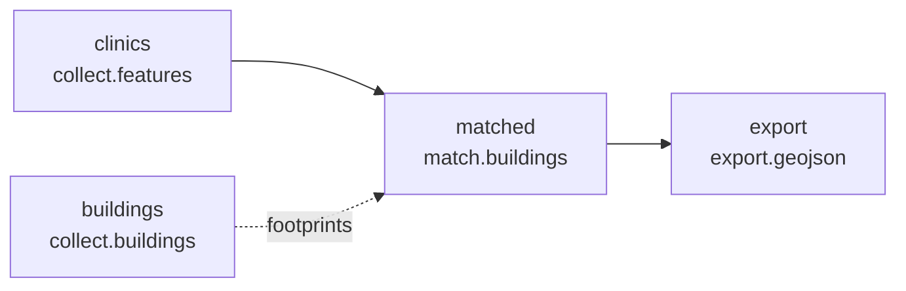

<div align="center">



[](https://github.com/Ppp2048/geoproduct-engineer-skill/actions/workflows/ci.yml)
[](LICENSE)


<br>


**[Quick start](#quick-start)** · **[Install](#installation)** · **[Examples](#example-workflows)** · **[Pipelines](#how-the-pipeline-engine-works)** · **[Data licences](#providers-and-data-licences)** · **[Limitations](#limitations)** · **[Docs](#documentation)**

</div>

GeoProduct Engineer helps AI agents research, build, check and deliver geographic datasets in which every location and attribute can be traced to its evidence. It has three parts that work together or alone:

<table>
<tr>
<th width="33%">Agent Skill</th>
<th width="33%">MCP server</th>
<th width="33%">Pipeline engine</th>
</tr>
<tr>
<td valign="top">Teaches an agent the method: plan the research, judge sources, match buildings, express uncertainty and report.<br><br><code>skills/geoproduct-engineer</code></td>
<td valign="top">Gives any MCP client the tools to do the work: collect, compute, validate and export.<br><br><code>geoproduct-mcp</code></td>
<td valign="top">Runs the work as repeatable, resumable stages, from Python or the <code>geoproduct</code> CLI.<br><br><code>geoproduct-core</code></td>
</tr>
</table>

> [!NOTE]
> **Pre-release (`0.1.0.dev0`).** Tested locally on Windows with Python 3.14, and by CI on Python 3.12 to 3.14 on Linux, macOS and Windows; the CI badge shows the latest result. The packages are not on PyPI yet, so run them from a clone. The interfaces may still change before 1.0.

## The problem

Ask an agent for "every hospital in this district, with its building" and you usually get a plausible list. Some coordinates are geocoded guesses. Some building links are assumptions, and some attributes come from nowhere in particular. Nothing tells you which is which.

GeoProduct Engineer makes that difference explicit and checkable:

| | A plain list | With GeoProduct Engineer |
|---|---|---|
| **Values** | Stated as facts | Each is a sourced fact, an estimate or an inference, with the source that supports it |
| **Locations** | A pair of numbers | Each says how it was obtained (address point, building footprint, centroid, approximate) and how precise it is |
| **Building links** | Assumed | `exact`, `probable`, `ambiguous`, `approximate_point` or `none`, with the reasons and candidates |
| **Disagreeing sources** | One value wins, silently | Both values kept side by side as a conflict |
| **Records it cannot resolve** | Filled in | Marked unresolved, with the reason |
| **Quality** | Unknown | A report with a score, check results, findings, and the licences and attribution the data inherits |

Nothing in the toolkit invents coordinates, sources, building links or missing values. What it cannot establish, it leaves open and says why.

<p align="center">
  
</p>

<details>
<summary><b>The exact rule behind each match status</b></summary>
<br>

| Status | When | Building named? |
|---|---|---|
| `exact` | A footprint contains the point, and a name, address or identifier agrees, or the point came from the footprint itself | Yes |
| `probable` | A footprint contains the point but nothing else confirms the link, or a single nearby footprint has supporting evidence | Yes, flagged as unconfirmed |
| `ambiguous` | The point is inside overlapping footprints, or two or more nearby candidates score within a margin of each other | No; every candidate is listed |
| `approximate_point` | A single footprint nearby, without supporting evidence | No; the point is kept as it is |
| `none` | No footprint within a distance that scales with the location's precision | No |

A record is never attached to the nearest building without evidence. [docs/architecture.md](docs/architecture.md#5-matching-and-resolution-rules) has the full rules.

</details>

## Quick start

You need [uv](https://docs.astral.sh/uv/) and Git. uv installs a suitable Python (3.12 or newer) if you don't have one. No account or key is needed, and the example pipeline runs offline.

```bash
git clone https://github.com/Ppp2048/geoproduct-engineer-skill.git
cd geoproduct-engineer-skill
uv sync
uv run geoproduct run examples/pipelines/hospitals.yaml
```

<p align="center">
  
  <br>
  <sub>A replay of a real run of this example. Run IDs differ each time.</sub>
</p>

The pipeline runs against **Sample Town**, a synthetic town built into the offline `fixture` provider. It is not a real place, and every result says so. The run:

1. collects hospitals and clinics;
2. merges a duplicate whose bed counts disagree, keeping both values;
3. matches building footprints: one exact, one probable, one ambiguous, one with none;
4. scores confidence;
5. validates and gates the result;
6. writes a quality report and a GeoJSON export.

The output is in `.geoproduct/runs/<run_id>/stages/`, with one folder per stage. The quality report is in `report/` and the GeoJSON in `geojson/`.

<details>
<summary><b>See one record from the export</b> (abridged)</summary>
<br>

The merged hospital: two sources gave different bed counts, so both are kept and the value is left empty until someone resolves it. Evidence IDs are shortened here.

```jsonc
{
  "name": "Sample General Hospital",
  "attributes": {
    "beds":  { "basis": "fact", "evidence_ids": ["ev_430e…", "ev_7600…"], "note": "sources disagree; see conflicts" },
    "phone": { "value": "+00 100 0001", "basis": "fact", "evidence_ids": ["ev_7600…"] }
  },
  "location": { "kind": "entrance", "precision_m": 10.0, "evidence_ids": ["ev_430e…"] },
  "building_match": {
    "status": "exact",
    "building_ref": { "provider": "fixture", "id": "b-110" },
    "reasons": ["the position is inside the footprint",
                "name agrees with footprint 'Sample General Hospital' (1.00)"]
  },
  "confidence": {
    "level": "medium", "score": 0.6,
    "reasons": ["one source describes it", "sources not evaluated", "exact building match",
                "location: entrance", "sources disagree: attributes.beds"]
  },
  "status": "conflicting",
  "conflicts": [{
    "field": "attributes.beds",
    "values": [{ "value": 120, "evidence_ids": ["ev_430e…"] },
               { "value": 110, "evidence_ids": ["ev_7600…"] }],
    "note": "sources disagree; the value is cleared until resolved"
  }],
  "merged": [{ "record_id": "fixture:poi-01", "score": 0.978,
               "reasons": ["same website", "name similarity 1.00", "11 m apart"] }]
}
```

</details>

<details>
<summary><b>See the quality report</b> (excerpt)</summary>
<br>

**Score: 0.94** (clean records count 1, records with only warnings count 0.75, records with errors count 0).

| Metric | Value |
|---|---|
| Records | 4 |
| Evidence coverage of facts | 100% |
| Conflicting | 25% |
| Location kinds | approximate 2, centroid 1, entrance 1 |
| Building matches | ambiguous 1, exact 1, none 1, probable 1 |

| Severity | Check | Record | Message |
|---|---|---|---|
| warning | conflicts | `fixture:poi-02` | sources disagree on attributes.beds |

The full report also gives the result of every check, and the licences and attribution of the sources.

</details>

The other examples are in [examples/](examples/README.md).

## How it fits together



**Who does what.**
- The agent does the research: finding sources, reading them, rating their reliability.
- The server records what the agent supplies and checks it. For example, an evidence excerpt is checked against the fetched page text.
- The server never runs code the agent wrote. Pipelines are built only from registered stages.

<details>
<summary><b>Why the skill and the server are separate</b></summary>
<br>

- The skill is knowledge: how to plan the research, judge sources, match buildings, express uncertainty and report. It works with any agent that reads Agent Skills, and it stays useful as a method even with no server attached.
- The server is capability: tools that collect, compute, validate and export, usable by any MCP client, with or without the skill.
- The core library has no MCP or LLM dependency at all.

Keeping them apart means each can be installed, versioned and replaced on its own.

</details>

## What it can do

| | |
|---|---|
| **Sources** | Register the sources the agent found, with ratings and a computed reliability score. Fetch them within limits: public addresses only, `robots.txt`, size and time caps. Keep their text so evidence excerpts can be checked. |
| **Collection** | Geocode and reverse geocode. Query OpenStreetMap features with structured tag filters (no raw Overpass QL) and building footprints. Import CSV, GeoJSON or JSON files. |
| **Preparation** | Normalise records. Merge duplicates, keeping disagreeing values as conflicts. Geocode records that have no location; public Nominatim is capped at 100 lookups per run. |
| **Building matching** | By containment and proximity, with name and address agreement. Every match states its status, method, score, reasons and candidates. |
| **Enrichment** | Count nearby features, find the polygons a record falls in, measure area, length and perimeter. |
| **Quality** | Per-record confidence with reasons. Dataset validation: coordinates, CRS, geometry, duplicates, area, outliers, evidence, conflicts and spatial rules. Quality gates. A Markdown and JSON quality report. |
| **Export** | RFC 7946 GeoJSON and UTF-8 CSV, with a manifest that holds counts, bounds, licences and file hashes. A GeoJSON export reloads without loss. |
| **Pipelines** | Declarative YAML or JSON specs, checked in one pass. Runs in the background, with progress and cancellation. Checkpoints per stage: a failed or cancelled run resumes where it stopped, even with corrected parameters. |

<details>
<summary><b>The MCP server: 21 tools, 2 prompts and read-only resources</b></summary>
<br>

| Area | Tools |
|---|---|
| Sources | `register_source`, `fetch_source_data` |
| Geography | `geocode`, `reverse_geocode`, `geocode_records`, `search_osm_features`, `get_building_footprints` |
| Records | `create_dataset`, `normalize_records`, `deduplicate_entities`, `match_building_footprints`, `enrich_records`, `score_confidence` |
| Quality and export | `validate_dataset`, `generate_quality_report`, `export_geo_dataset` |
| Pipelines | `create_geo_pipeline`, `run_geo_pipeline`, `get_pipeline_status`, `get_pipeline_results`, `cancel_geo_pipeline` |

**Prompts:** `plan_geographic_dataset` and `audit_dataset_quality`.<br>
**Resources:** a methodology guide, the stage registry, provider status, JSON Schemas, runs and datasets.

</details>

## Installation

### MCP server

Point your MCP client at the server in your clone. Once the packages are published, `uvx geoproduct-mcp` will replace `uv run --directory …`.

<details open>
<summary><b>Claude Desktop, Cursor and other clients with an <code>mcpServers</code> block</b></summary>
<br>

```json
{
  "mcpServers": {
    "geoproduct": {
      "command": "uv",
      "args": ["run", "--directory", "/path/to/geoproduct-engineer-skill", "geoproduct-mcp"],
      "env": {
        "GEOPRODUCT_WORKSPACE": "/path/to/my-research/.geoproduct",
        "GEOPRODUCT_USER_AGENT": "my-research/0.1 (you@example.org)"
      }
    }
  }
}
```

</details>

<details>
<summary><b>Claude Code</b></summary>
<br>

```bash
claude mcp add geoproduct -e GEOPRODUCT_USER_AGENT="my-research/0.1 (you@example.org)" -e GEOPRODUCT_WORKSPACE=/path/to/my-research/.geoproduct -- uv run --directory /path/to/geoproduct-engineer-skill geoproduct-mcp
```

</details>

### Agent Skill

Copy the skill's folder, keeping its name, to where your agent looks for skills. For Claude Code, that is `~/.claude/skills/` for every project, or `.claude/skills/` inside one project:

```bash
cp -r skills/geoproduct-engineer ~/.claude/skills/
```

The skill is self-contained, and its two helper scripts need only the Python standard library. Without the server it still guides the method, and it says which steps it could not carry out.

### Configuration

Everything is set through environment variables, and none of them holds a secret:

| Variable | Purpose |
|---|---|
| `GEOPRODUCT_WORKSPACE` | Where sources, datasets, runs and the cache are kept. Use an absolute path for MCP clients. |
| `GEOPRODUCT_ALLOWED_DIRS` | Other folders the tools may read from and export to. Every other path is refused. |
| `GEOPRODUCT_USER_AGENT` | Identifies you to the public OpenStreetMap services. It is required for them; include a way to reach you. |
| `GEOPRODUCT_NOMINATIM_URL`, `GEOPRODUCT_OVERPASS_URL` | Use a self-hosted or other instance |

[docs/configuration.md](docs/configuration.md) lists every variable and option, the HTTP transport, what the server can reach and the workspace layout.

## Example workflows

### With an agent

Install the skill and the server, then ask in plain language:

> *Build a dataset of the libraries in this town, with opening hours where a source states them, matched to their buildings.*

The skill leads the agent through these steps:



The agent asks for your confirmation before more than 25 requests to an external service.

<details>
<summary><b>The skill's 11 workflows</b></summary>
<br>

| Workflow | For |
|---|---|
| [Geographic research](skills/geoproduct-engineer/workflows/geographic-research.md) | Finding and locating every X in an area, end to end |
| [Source discovery](skills/geoproduct-engineer/workflows/source-discovery.md) | Which sources to use, and how far to trust them |
| [Dataset creation](skills/geoproduct-engineer/workflows/dataset-creation.md) | From research, files or map data to a clean dataset |
| [Entity resolution](skills/geoproduct-engineer/workflows/entity-resolution.md) | Duplicates, aliases and conflicting values |
| [Building matching](skills/geoproduct-engineer/workflows/building-matching.md) | Linking records to building footprints, saying how sure each link is |
| [Spatial analysis](skills/geoproduct-engineer/workflows/spatial-analysis.md) | Proximity, containment and measurement |
| [Infrastructure research](skills/geoproduct-engineer/workflows/infrastructure-research.md) | Networks and assets: transport, power, water, telecom and roads |
| [Map accuracy audit](skills/geoproduct-engineer/workflows/map-accuracy-audit.md) | Checking an existing map or dataset before it is published or relied on |
| [Quality assurance](skills/geoproduct-engineer/workflows/quality-assurance.md) | Deciding whether a dataset is good enough to deliver |
| [Pipeline construction](skills/geoproduct-engineer/workflows/pipeline-construction.md) | Writing and running a pipeline for work that is repeated, long or must be reproducible |
| [Map integration](skills/geoproduct-engineer/workflows/map-integration.md) | Adding new data to a map the user already has, without breaking it |

</details>

### With the CLI

The four example pipelines run offline:

| Pipeline | Shows |
|---|---|
| [`hospitals.yaml`](examples/pipelines/hospitals.yaml) | Duplicates with conflicting values, building matches of every status, a quality gate |
| [`commercial-buildings.yaml`](examples/pipelines/commercial-buildings.yaml) | Several queries combined, footprints in place of points, floor area, district lookup, CSV and GeoJSON |
| [`transport.yaml`](examples/pipelines/transport.yaml) | Spatial rules: a stop far from any street is caught; a failing gate fixed by resuming with a new parameter |
| [`csv-enrich.yaml`](examples/pipelines/csv-enrich.yaml) | A user CSV geocoded, with a bad row rejected and an unknown address left unresolved, with the reason |

```bash
uv run geoproduct plan examples/pipelines/transport.yaml
uv run geoproduct run examples/pipelines/transport.yaml --param max_stop_distance_m=5   # fails at the gate
uv run geoproduct resume RUN_ID --param max_stop_distance_m=30                          # reruns only what changed
```

To use real data, override the `provider` and `area` parameters (for example `--param provider=overpass`) and set `GEOPRODUCT_USER_AGENT`.

## How the pipeline engine works

A pipeline is a YAML or JSON spec: a list of stages, each naming a registered stage type, its input and its options. Parameters let one spec serve many areas.

```yaml
apiVersion: geoproduct/v1
kind: Pipeline
name: clinics
params:
  area: {bbox: [0.0015, 0.0015, 0.0097, 0.0097]}
stages:
  - id: clinics
    uses: collect.features
    with: {provider: fixture, area: {param: area}, tags: {amenity: clinic}}
  - id: buildings
    uses: collect.buildings
    with: {provider: fixture, area: {param: area}}
  - id: matched
    uses: match.buildings
    input: clinics
    with: {buildings: {stage: buildings}}
  - id: export
    uses: export.geojson
    input: matched
    with: {name: clinics}
```

Stages are linked by `input` and `{stage: …}` references, which point only to earlier stages. They run one at a time, in the order written:



- **Checking.** The whole spec is checked before anything runs: unknown stages (with suggestions), inputs, option types, and the kinds of data passed between stages. Every problem is listed at once.
- **Checkpoints.** Each stage's output is saved with a fingerprint of its type, version, options and inputs. Resuming skips every stage whose fingerprint still matches, so changing one option reruns only that stage and what follows it.
- **Failures.** Retry-safe stages retry rate limits, outages and timeouts with backoff, honouring `Retry-After`. Invalid records are set aside with reasons rather than failing the run, up to a limit. Ctrl+C, cancellation and crashes leave a resumable run.
- **Provenance.** A run records the spec, library versions, provider endpoints and data timestamps, and each stage's request count and cache hits. With the same provider data, a run gives the same output.

<details>
<summary><b>The 18 stages a pipeline can use</b></summary>
<br>

| Step | Stages |
|---|---|
| Collect | `collect.features`, `collect.buildings`, `collect.file`, `collect.records` |
| Prepare | `normalize.records`, `combine.records`, `resolve.deduplicate`, `geocode.records` |
| Match and enrich | `match.buildings`, `enrich.nearby`, `enrich.within`, `enrich.measure` |
| Check | `quality.confidence`, `validate.dataset`, `quality.gate`, `report.quality` |
| Export | `export.geojson`, `export.csv` |

`uv run geoproduct stages` lists them, and `uv run geoproduct stage <name>` describes one with its options.

</details>

[docs/architecture.md](docs/architecture.md) covers the data contracts, matching rules, engine and server in detail.

## Providers and data licences

| Provider | Gives | Needs | Data licence |
|---|---|---|---|
| `fixture` | Everything, offline, over the synthetic Sample Town | Nothing | CC0 (synthetic) |
| `nominatim` | Geocoding and reverse geocoding | `GEOPRODUCT_USER_AGENT` for the public instance | ODbL 1.0 |
| `overpass` | OpenStreetMap features and building footprints | `GEOPRODUCT_USER_AGENT` for the public instance | ODbL 1.0 |
| Files | Your own CSV, GeoJSON or JSON | An allowed folder | Whatever you state |
| Web sources | Evidence the agent finds and fetches | Public addresses only | Each source's own terms |

**The public OpenStreetMap services are shared and free.** The providers respect their policies:
- one request per second to Nominatim, and at most 100 geocodes per run;
- one Overpass query at a time;
- an identifying User-Agent, and caching.

For volume, point the providers at your own instance.

> [!IMPORTANT]
> **Your datasets carry their sources' licences, not this project's.** Data from OpenStreetMap is under the ODbL, and publishing a dataset derived from it brings attribution and share-alike duties. Every export lists the licences and attribution of the sources it uses, so you can meet them. See [OpenStreetMap's copyright page](https://www.openstreetmap.org/copyright).

## Limitations

- **Pre-release.** Not on PyPI yet, and interfaces may change before 1.0.
- **Live services.**
  - Live Nominatim has been tested against the public service.
  - Live Overpass has been tested only against service-shaped mock responses; the opt-in live tests have not yet reached the public service.
  - Public instances are rate-limited and can be slow or unavailable.
- **Providers.** Only OpenStreetMap services are built in. Overture Maps and commercial providers are not, and nothing loads third-party provider plug-ins yet.
- **Exports.** GeoJSON and CSV only.
- **Research.** PDF text is not extracted, so evidence excerpts from PDFs remain `not_checked`. The server does not search the web: the agent researches with its own tools, and the server records and checks what it supplies.
- **Single user.** The HTTP transport has no authentication, so it serves only loopback addresses. One workspace belongs to one user. The guard against running a run twice works within one process only.
- **Scale.** Datasets are held in memory, and a stage may output at most 100,000 records by default. That suits datasets of thousands to tens of thousands of records.
- **Testing.** The skill has been evaluated on a few cases, which did not yet separate it from a capable agent without it.

## Roadmap

These are directions, not promises:

- [ ] Publish `geoproduct-core` and `geoproduct-mcp` to PyPI
- [ ] An Overture Maps provider for buildings and places, always limited to an area
- [ ] GeoPackage and GeoParquet export
- [ ] PDF text extraction for evidence checks
- [ ] Harder skill evaluations, including cases that tempt invention, licence traps and conflicting sources
- [ ] A provider plug-in interface

## Documentation

| Document | Contents |
|---|---|
| [docs/architecture.md](docs/architecture.md) | Components, data contracts, engine, matching rules, providers, MCP server, security, testing |
| [docs/configuration.md](docs/configuration.md) | Running the server, environment variables, client setup, skill installation |
| [docs/decisions.md](docs/decisions.md) | Build stages and the decisions taken, with reasons |
| [docs/research.md](docs/research.md) | The research behind the design: related projects, libraries, providers and licensing |
| [docs/releasing.md](docs/releasing.md) | Versioning and the release checklist |
| [examples/](examples/README.md) | The example pipelines |
| [skills/geoproduct-engineer/](skills/geoproduct-engineer/SKILL.md) | The Agent Skill |
| [CHANGELOG.md](CHANGELOG.md) | Changes by version |

## Contributing

Contributions are welcome. [CONTRIBUTING.md](CONTRIBUTING.md) explains the development setup, the checks a change must pass and the project's ground rules, such as never inventing data and tests that need no network. To report a vulnerability, see [SECURITY.md](SECURITY.md).

## Licence

The code is licensed under the [Apache License 2.0](LICENSE). See [NOTICE](NOTICE). Data you collect or produce with it is covered by its sources' licences, as described above.
