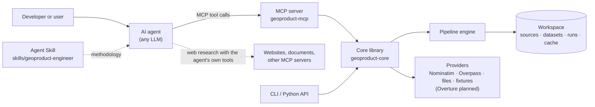

# Architecture

Status: approved in Stage A (2026-11-21). Updated as built through Stage G (2026-11-22): sections 2 and 4 to 8 describe what exists now. Parts marked *planned* arrive in later stages. The reasoning behind each choice is in [research.md](research.md); decisions are logged in [decisions.md](decisions.md).

## 1. Components and responsibilities



| Part | Does | Does not |
|---|---|---|
| **Agent** (LLM) | Understands the request, plans, finds sources, judges reliability, decides the next step, explains confidence | Run code of its own invention through the server |
| **Agent Skill** | Teaches the method: plan, evidence, tool choice, validation, reporting. Detects the server and falls back to methodology if it is missing. | Depend on one LLM vendor, or on the server being present |
| **MCP server** | Exposes structured tools, resources and prompts over the core. Validates input. Runs pipelines as background jobs. | Research on its own, or rate sources by itself; it records and computes what the agent supplies |
| **Core library** | Schemas, providers, geometry and matching logic, the pipeline engine, exports, reports | Import MCP, or call any LLM |

The core runs without MCP: you can use it from Python or the `geoproduct` CLI. The MCP server runs without the skill. The skill runs without the MCP server.

## 2. Repository layout

```
geoproduct-engineer-skill/
├── packages/
│   ├── geoproduct-core/            # distribution "geoproduct-core", import "geoproduct"
│   │   ├── src/geoproduct/
│   │   │   ├── schemas/            # pydantic v1 contracts and JSON Schema export
│   │   │   ├── engine/             # stage decorator and registry, spec checking, runner, run store, fingerprints
│   │   │   ├── stages/             # registered stages: collect, prepare, spatial, quality, output
│   │   │   ├── providers/          # protocol, registry, HTTP plumbing, fixture, OSM conversion, nominatim, overpass
│   │   │   ├── geo/                # shapes, metric measures (local projection), building matching
│   │   │   ├── resolve/            # name and address keys, similarity, deduplication
│   │   │   ├── fetch.py            # source fetching: public addresses only, robots.txt, limits, page text
│   │   │   └── cli.py              # the `geoproduct` command
│   │   └── tests/
│   └── geoproduct-mcp/             # distribution "geoproduct-mcp", console script "geoproduct-mcp"
│       ├── src/geoproduct_mcp/     # server.py (tools, resources, prompts), tools/, calls.py, store.py, jobs.py, guide.md
│       └── tests/
├── skills/
│   └── geoproduct-engineer/        # folder name must equal the skill name
│       ├── SKILL.md
│       ├── workflows/              # 11 workflow guides
│       ├── references/             # evidence, sources, matching, providers, pipeline spec, tool map
│       ├── scripts/                # standard-library helpers for use without the server
│       └── evals/                  # test cases for the skill (prompt, expected outcome, graders)
├── schemas/v1/                     # generated JSON Schemas (published contracts)
├── examples/                       # pipeline specs + fictional sample data
├── tests/
│   ├── skill/                      # the skill against the code: format, links, names, scripts
│   ├── e2e/                        # research to export, failure and recovery; offline
│   ├── live/                       # opt-in checks against the public OpenStreetMap services
│   └── release/                    # versions, licence copies, changelog and CI pins agree
├── docs/                           # research, architecture, decisions, configuration, releasing
├── pyproject.toml                  # uv workspace root (dev tools only)
├── uv.lock
├── .github/                        # CI (lint, test matrix, package build and check), Dependabot, issue forms
└── README.md, LICENSE, NOTICE, CHANGELOG.md, CONTRIBUTING.md, SECURITY.md, .env.example
```

The PRD suggested three separate packages (`core`, `schemas`, `providers`). They are merged into one installable core with subpackages, because none of them is useful without the others. Providers stay **pluggable**: the registry takes any `Provider`, and the `geoproduct.providers` entry-point group is reserved so a third-party package can add one later without touching the core (*planned*; nothing loads plug-ins yet).

**Dependencies.**

| Distribution | Dependencies |
|---|---|
| Core | `pydantic`, `shapely`, `rapidfuzz`, `pyyaml`, `numpy`, `httpx2` and `httpcore2` (decision 33). `pyproj` only when a stage needs a projected CRS (decision 20). |
| Core extras | `[gpkg]` adds `pyogrio`; `[overture]` adds `overturemaps` |
| MCP server | `geoproduct-core` (same version) and `mcp>=2.3,<3` |

Python ≥ 3.12. CI runs on 3.12, 3.13 and 3.14, on Linux, Windows and macOS.

## 3. Data contracts (`geoproduct/v1`)

Every contract is a pydantic model with `schema_version: "geoproduct/v1"`, and is exported to `schemas/v1/*.schema.json` (JSON Schema 2020-12, which MCP output schemas also use). A breaking change gets a new version folder; old readers keep working.

| Contract | Key fields |
|---|---|
| **Source** | `id`, `type` (one of `official_government`, `official_organisation`, `osm`, `open_data_portal`, `public_api`, `commercial_api`, `document`, `user_file`, `other`), `url_or_ref`, `licence`, `retrieved_at`, `content_sha256`, `evaluation` (authority, accuracy, freshness, coverage, licensing, geographic precision, verifiability: each 0–3 with a rationale), `evaluation_score` (weighted, computed) |
| **Evidence** | `id`, `source_id`, `supports` (field names), `excerpt`, `excerpt_check` (`verified` / `not_found` / `not_checked`), `retrieved_at`, `last_verified` |
| **Record** | `id`, `name`, `aliases`, `category`, `attributes` (value plus `basis` (`fact` / `estimate` / `inference`) and `evidence_ids`), `geometry` (GeoJSON, WGS 84), `location` (`kind`: `building_footprint` / `address_point` / `entrance` / `centroid` / `approximate` / `unknown`; `precision_m`), `building_match`, `confidence`, `status` (`resolved` / `unresolved` / `conflicting` / `rejected`), `limitations` |
| **BuildingMatch** | `status` (`exact` / `probable` / `ambiguous` / `approximate_point` / `none`), `building_ref` (provider, id), `method`, `score`, `reasons[]`, `candidates[]` (ref, distance, contains, name similarity, score) |
| **Confidence** | `level` (`high` / `medium` / `low` / `unresolved`), `score` 0–1, `reasons[]`. Derived from independent sources, source scores, agreement, location precision and match status. |
| **Dataset** | `id`, `records` or a stored file, `crs` (always EPSG:4326 on export), `provenance` (sources, stages, run id), `licences[]`, `attribution` |
| **PipelineSpec / RunRecord / StageManifest** | See section 4 |
| **GeoError** | `code`, `message`, `stage`, `retryable`, `details`, `hint`. Used for every tool and stage error. |

Facts, estimates, inferences and unresolved records are separated at field level (`basis`) and at record level (`status`). The model has no way to state a coordinate or building link without a source or method.

## 4. Pipeline engine

**Spec.** YAML or JSON, validated before anything runs. There is no templating and no code; references are explicit objects.

```yaml
apiVersion: geoproduct/v1
kind: Pipeline
name: hospitals-to-buildings
params:
  provider: fixture
  area: {bbox: [0.0015, 0.0015, 0.0097, 0.0097]}
stages:
  - id: collect
    uses: collect.features            # a registered stage name
    with: {provider: {param: provider}, area: {param: area}, tags: {amenity: hospital}}
  - id: normalize
    uses: normalize.records
    input: collect
  - id: dedupe
    uses: resolve.deduplicate
    input: normalize
    with: {name_threshold: 0.88, max_distance_m: 150}
  - id: footprints
    uses: collect.buildings
    with: {provider: {param: provider}, area: {param: area}}
  - id: match
    uses: match.buildings
    input: dedupe
    with: {buildings: {stage: footprints}, max_distance_m: 30}
  - id: scored
    uses: quality.confidence
    input: match
  - id: check
    uses: validate.dataset
    input: scored
    with: {checks: [coordinates, geometry, duplicates, within_area], area: {param: area}}
  - id: gate
    uses: quality.gate
    input: check
    with: {min_score: 0.7, max_unresolved_share: 0.2}
  - id: export
    uses: export.geojson
    input: scored
```

The four runnable examples are in `examples/pipelines/`.

**Registry.** Each stage is a plain function registered with the `@stage` decorator, which declares:
- a name and a version;
- a typed parameter model, an input kind and an output kind (`records`, `buildings`, `report` or `files`);
- the kinds it accepts through `{stage: ...}` references;
- whether it is `retry_safe`.

The function receives `(ctx, input, params)` and returns a `StageResult` with the output, rejects and notes. Specs can only name registered stages. When a pipeline is checked, every problem is reported in one pass: unknown stages (with suggestions), wrong input counts or kinds, invalid parameters and wrong reference kinds. References can only point to earlier stages, so cycles cannot occur. The MCP server adds an estimate of external requests per stage, used for confirmation (section 7).

**Stages.**

| Group | Built | Planned |
|---|---|---|
| Collect | `collect.records` (agent-supplied), `collect.file` (CSV, GeoJSON, JSON), `collect.features`, `collect.buildings` (any provider with that capability) | GeoPackage in `collect.file` (extra); Overture through a provider (extra) |
| Prepare | `combine.records`, `normalize.records`, `resolve.deduplicate`, `geocode.records` | |
| Match and enrich | `match.buildings`, `enrich.nearby`, `enrich.within`, `enrich.measure` (area, length, perimeter) | Distance and buffer measures |
| Quality | `quality.confidence` (per record), `validate.dataset` (dataset score and findings), `quality.gate` | |
| Output | `export.geojson` (with a dataset manifest), `export.csv`, `report.quality` (Markdown and JSON) | `export.json`, `export.gpkg` (extra) |

Source evaluation needs no stage: the agent's ratings travel on each `Source`, and the score is derived from them (decision 15). The `register_source` tool records them.

**Discovery and parsing.** The PRD's "discovery" stage is the agent's work; the engine records its results as Sources. Parsing covers structured formats only. The agent turns web pages into records, and their evidence can be checked.

**Run store** (workspace, default `./.geoproduct`, set with `GEOPRODUCT_WORKSPACE`):

```
runs/<run_id>/run.json       # status, per-stage state and counts, errors, library versions
runs/<run_id>/spec.json      # the spec as run (parameters changed on resume are saved here)
runs/<run_id>/events.jsonl   # append-only execution log
runs/<run_id>/cancel         # present while a cancellation is pending
runs/<run_id>/stages/<stage_id>/
    manifest.json            # fingerprint, parameters, output hashes, counts, providers used
    rejects.jsonl            # items the stage could not use, with reasons
    records.geojson + provenance.json    # records: open in any GIS tool
    buildings.geojson + provenance.json  # building footprints
    report.json                          # quality report
    files.json + the exported files      # exports
sources/<source_id>/         # registered sources; fetched content, its text and fetch.json
datasets/<dataset_id>/       # datasets made by MCP tools outside a pipeline
cache/http/<provider>/       # cached provider responses
```

**Behaviour.**

| Concern | How it works |
|---|---|
| Ordering | Stages form a DAG through `input` and `{stage: ...}` references. Because references only point backwards, the order of the spec is already a valid topological order. Stages run one at a time in that order, which keeps public APIs polite. |
| Checkpoints and resume | Each stage manifest stores a fingerprint: the hash of the stage name and version, its parameters and its inputs' fingerprints. A resumed run skips a stage whose fingerprint and output hash still match. Changing a parameter re-runs only that stage and what follows it. |
| Retries | Only for `retry_safe` stages and requests. Exponential backoff with jitter, honouring `Retry-After`, with a maximum number of attempts. |
| Partial failure | A bad record goes to `rejects.jsonl` with a reason. The stage fails only above `max_reject_share`, and earlier outputs are kept. |
| Cancellation | A cancel flag (in-process event, or a marker file written by another process) that stages check between items with `ctx.check()`. Ctrl+C is recorded the same way. Status becomes `cancelled`, and the run can be resumed later. |
| Quality gates | `quality.gate` fails the run with `quality_gate_failed`, listing the violated thresholds. Nothing after the gate runs, so place `report.quality` before the gate to keep a readable report. |
| Limits | Per-stage `timeout_s`, checked cooperatively; maximum records a stage may output (`Limits.max_records`); file size and row limits in `collect.file`; provider batch limits (`policy_refused`); a 30-second timeout (longer for Overpass queries), a 10-second limit on connecting, and a 50 MB cap on every provider response. |
| Unexpected errors | An error outside any stage, such as a disk error while saving the run record, marks the run failed with a structured error instead of leaving it `running`; it can be resumed (decision 60). |
| Observability | `run.json` status (`pending` / `running` / `succeeded` / `failed` / `cancelled`), current stage, progress counts, an event log and a run report. |
| Reproducibility | A run records the spec, library versions, and each stage's provider endpoints and data timestamps. Source and evidence ids are derived from their content. With the same provider data, a run gives identical outputs. Stage manifests also record each provider's request count and cache hits. |

## 5. Matching and resolution rules

**Entity resolution** (`resolve.deduplicate`):
1. **Normalise names and addresses:** case, accents, punctuation, legal suffixes, common abbreviations, plus configurable alias lists.
2. **Block** candidate pairs by spatial grid cell and name token, to avoid comparing every pair.
3. **Score each pair** with RapidFuzz token similarity, distance and shared identifiers (website, phone, OSM or GERS id).
4. **Cluster** with explicit thresholds.

The output is clusters with reasons. Conflicting attributes are kept side by side and the record is marked `conflicting`, never silently overwritten. One organisation with several sites stays as several records linked by `organisation_id`.

**Building matching** (`match.buildings`), in this order:
1. **Containment:** a footprint contains the point. This alone is `probable`. It becomes `exact` only when a name, address or identifier agrees, or when the point comes from the footprint itself.
2. **Proximity:** only within a distance that scales with the location's precision. A single candidate with supporting evidence is `probable`; without evidence it is `approximate_point`.
3. **Ambiguity:** when two or more candidates fall within a score margin, the result is `ambiguous`, with all candidates listed.
4. **Never** attach a record to the nearest building without evidence. With no candidate, the result is `none`.

Every decision returns `reasons` and `candidates`, so the agent and the user can audit it.

**Confidence** (`quality.confidence`, decision 22). Each record gets a score from 0 to 1, the sum of four parts, each with a reason:

| Part | Weight | Full marks when |
|---|---|---|
| Evidence | 0.35 | Two or more independent sources describe the record. One gives 0.2. A geocoder or footprint that only placed the record counts under location, not here. |
| Source quality | 0.2 | The best cited source has a high evaluation score. Unevaluated sources give 0.1. |
| Location | 0.3 | The location is a footprint or an entrance. Other kinds count for less: address point 0.85, centroid 0.6, approximate 0.35, unknown 0.25. An exact building match raises the location to 1, a probable one to 0.85. A footprint assigned from a probable match also counts 0.85 (decision 54). A precision worse than 100 m halves it. |
| Consistency | 0.15 | No conflicts, and every fact has evidence. With conflicts this part is 0; with unsupported facts it is 0.05. |

The levels are: high ≥ 0.75, medium ≥ 0.5, low ≥ 0.25. A record without geometry is `unresolved` whatever its score.

## 6. Providers

- **Protocol.** A `Provider` declares:
  - its capabilities: `geocode`, `reverse_geocode`, `features`, `buildings` (points of interest such as Overture places come through `features`);
  - attribution and licence;
  - a usage policy: rate, concurrency, whether bulk use is allowed, largest batch, whether a User-Agent is required, terms URL;
  - whether it uses the network, the environment variables it reads (`settings` for ordinary ones, `credentials` for secrets, names only), and whether it is `configured`, with a note saying what is missing.

  Errors are typed: `rate_limited`, `provider_unavailable`, `provider_error`, `timeout`, `too_large`, `auth_missing`, `policy_refused`, `capability_unsupported`. Providers are synchronous; the engine calls them from worker threads. A provider that is not configured fails with `auth_missing` before any request.
- **Shared plumbing** (`providers/http.py`). Each live provider gets an `httpx2` client with:
  - a throttle that spaces requests 5% wider than the policy's rate and limits concurrency, across all threads of the process (decision 41);
  - an on-disk cache in `cache/http/<provider>/`, keyed by a SHA-256 of the request, kept for `GEOPRODUCT_CACHE_TTL_HOURS` (default 7 days);
  - a 30-second timeout (longer for Overpass queries), a 10-second limit on connecting (decision 61), and a 50 MB cap per response;
  - at most two short retries on 429, 5xx and timeouts, waiting no more than 10 seconds. A longer `Retry-After` is passed to the engine as `retry_after_s`, so the engine backs off instead of a thread sleeping;
  - the User-Agent from `GEOPRODUCT_USER_AGENT`, followed by `geoproduct-core/<version>`.
- **Built in.**
  - `fixture`: offline and deterministic, over the fictional Sample Town.
  - `nominatim`: forward and reverse geocoding. On the public instance: 1 request per second, one at a time, at most 100 geocodes per run (decision 35), and a User-Agent required. A self-hosted instance (`GEOPRODUCT_NOMINATIM_URL`) can go faster (`GEOPRODUCT_NOMINATIM_RATE`) and has no batch cap. Candidates carry no score, because Nominatim's `importance` is not a match score, so two or more candidates leave a record unresolved (decision 34). The location kind follows the result: `address_point` with a house number, `centroid` for a precise place, otherwise `approximate`; the precision is half the result's bounding-box diagonal.
  - `overpass`: features and building footprints. Structured tag filters are compiled to Overpass QL; raw QL is never accepted. Areas are a bbox (split at the antimeridian), a radius or a polygon; a polygon with more than 1,000 points is queried by its bbox and filtered locally. One query at a time. A response that reports a server-side error or timeout in its `remark` is refused rather than used as a partial answer (decision 36). One result more than the limit is requested, to detect truncation.
  - OpenStreetMap conversion (`providers/osm.py`): elements become records (`osm:node/…`, `osm:way/…`, `osm:relation/…`) or footprints (provider `osm`, decision 37). Ways and multipolygon relations become polygons; tags are kept as facts; licence ODbL-1.0, attribution "© OpenStreetMap contributors".
  - Local files are not a provider: `collect.file` and `create_dataset` read them.
  - *Planned:* `overture`, as an extra, always limited to a bbox.
- **Configuration.** Environment variables only; see [configuration.md](configuration.md). Endpoint URLs may not carry credentials, queries or fragments, and the public instances are recognised by host (decision 40). No built-in provider needs a secret.

## 7. MCP server

**Transports.** stdio by default (`geoproduct-mcp`), or Streamable HTTP with `--http` on `127.0.0.1` only, because the server has no authentication (decision 42). The SDK negotiates protocol versions from 2024-11-05 to 2026-07-28. All state lives in the workspace behind server-issued ids (`source_id`, `dataset_id`, `run_id`), so no MCP session state is needed. Large data never travels through the model's context: tools take and return handles plus small previews.

**Tools.** The PRD proposed 25; overlapping ones are merged into 20 (decision 38). Stage F added `geocode_records` (decision 55), making 21.

| Group | Tool | Notes |
|---|---|---|
| Sources | `register_source` | Records a source the agent found, with the agent's ratings, and computes its score. Registering the same URL again updates it in place. Replaces `research_sources`, because the server does not research. |
| | `fetch_source_data` | Fetches a registered URL or file within limits (public addresses only, `robots.txt`, content types, size and time). Stores the content, its SHA-256 and its text, so evidence excerpts can be checked. |
| Geography | `geocode` | Forward geocoding: candidates with location kind and precision, plus attribution. Also covers `search_places`. |
| | `reverse_geocode` | |
| | `geocode_records` | Runs `geocode.records` on a dataset: only records without a location, one request each, each location citing the geocoder. More than 25 requests to an online provider need `confirm: true` (decision 55). |
| | `search_osm_features` | Structured tags and an area; no raw Overpass QL. Returns a dataset. |
| | `get_building_footprints` | Returns a dataset of footprints. |
| Records | `create_dataset` | Exactly one of: inline records (with sources and evidence; excerpts are checked against fetched text), a file, a fetched source in CSV, JSON or GeoJSON, or two or more records datasets to combine (`dataset_ids`, decision 49). Invalid rows are rejected with reasons. |
| | `normalize_records` | |
| | `deduplicate_entities` | |
| | `match_building_footprints` | |
| | `enrich_records` | `nearby`, `within` or `measure` (area of polygons; length of lines, or perimeter of polygons) |
| | `score_confidence` | Per-record confidence with reasons (`quality.confidence`) |
| Quality | `validate_dataset` | Built-in checks, plus spatial rules against a reference dataset. Merges three proposed validation tools. |
| | `generate_quality_report` | Markdown and JSON, with the quality score |
| | `export_geo_dataset` | GeoJSON or CSV, with a manifest. Optionally copied to an allowed folder; never replaces a different file without `overwrite: true`. |
| Pipelines | `create_geo_pipeline` | Checks a spec and records a pending run, with its plan, an estimate of external requests and warnings (for example, a provider that is not configured) |
| | `run_geo_pipeline` | Starts a pending run, resumes a failed or cancelled one (with changed parameters if given), or creates and starts a new one. Runs in the background and returns `run_id`. Replaces `resume_geo_pipeline` (decision 39). |
| | `get_pipeline_status` | |
| | `get_pipeline_results` | Each finished stage's output as a dataset handle, with a preview |
| | `cancel_geo_pipeline` | |

- **Datasets.** Each tool that produces data returns a `dataset_id` (`ds_…`), item and reject counts, a preview of up to five items and the attribution. A pipeline stage's output is addressed as `<run_id>/<stage_id>` and read in place. Tools check the kind (`records`, `buildings`, `report`, `files`) and explain mismatches. A tool that fails leaves no dataset behind.
- **Outputs.** Every tool has an output schema; the result is a typed model as structured content, plus a one-line text summary.
- **Errors.** An error result (`isError`) carries `structuredContent.error` in the `GeoError` shape and the text `code: message`. Validation problems are listed without echoing the input values.
- **Annotations.** Every tool sets the read-only and open-world hints; tools that write are marked not destructive, and `cancel_geo_pipeline` idempotent.
- **Progress and cancellation.** Blocking work runs in a worker thread. Progress is forwarded to the client at most twice a second. A cancelled request sets the work's cancel flag, which stages check between items; a provider request already in flight finishes or times out first.
- **Confirmation.** `run_geo_pipeline` estimates external requests: one per `collect.features` or `collect.buildings` stage, and the provider's largest batch for `geocode.records` (100 on public Nominatim). A stage whose provider sets no limit is counted as unbounded. Above 25 requests, or with anything unbounded, the call needs `confirm: true`; otherwise it fails with `confirmation_required`, and the run stays pending with its id and the estimate in the error (decision 43). `geocode_records` applies the same threshold to the records it would look up (decision 55).
- **Background runs.** Pipelines run on daemon threads in the server process. If the server stops, the run still says `running` but `get_pipeline_status` reports `active: false`; resume it with `run_geo_pipeline`.

**Resources.**

| URI | Contents |
|---|---|
| `geoproduct://guide` | A short methodology for clients without the skill |
| `geoproduct://stages` | The registry, with parameter schemas |
| `geoproduct://providers` | Provider status, usage policies and attribution |
| `geoproduct://schemas/v1/{name}` | The published JSON Schemas |
| `geoproduct://runs/{run_id}` | A run record and its event log |
| `geoproduct://datasets/{dataset_id}` | A dataset's description and files |

**Prompts.** `plan_geographic_dataset` and `audit_dataset_quality`, as templates for clients that don't support skills.

## 8. Agent Skill

The skill teaches an agent to research, build and check geographic datasets: how to reason about a request and when to call which tool, not a list of tools. It follows the Agent Skills specification and uses progressive disclosure: only the name and description are always loaded, `SKILL.md` when the skill activates, and workflows and references when a step needs them.

- **`SKILL.md`** (about 170 lines; about 3,900 tokens at four characters a token, under the 5,000 the specification recommends):
  - ground rules: never invent coordinates, URLs, building links or attributes; keep facts, estimates and inferences apart; report what is uncertain;
  - step 0, the execution mode: **MCP** (the `geoproduct-mcp` tools are present), **CLI** (the `geoproduct` command is installed), or **method only**. Without tools the skill still gives the method, and says which steps it could not run and what the user would need;
  - an eight-step loop: understand, plan (direct tool calls or a pipeline), choose sources, collect with evidence, resolve, locate and match buildings, validate, deliver;
  - tool use: reading structured results, an error-code table with the right response to each, avoiding needless calls, and asking before large or unbounded jobs;
  - an answer template, and index tables pointing at the workflows and references.
- **`workflows/`**: the 11 PRD workflows. Each is a numbered procedure with tool calls, pitfalls, and what to do without the server:
  - geographic research and source discovery;
  - dataset creation and entity resolution;
  - building matching and map accuracy audits;
  - infrastructure research and spatial analysis;
  - existing-map integration;
  - quality assurance and pipeline construction.
- **`references/`**:
  - `mcp-tools.md`: every tool, resource, prompt and CLI equivalent, with their parameters;
  - `pipeline-spec.md`: the spec format, the stage catalogue and patterns;
  - `evidence-and-confidence.md`: records, evidence, location kinds and the confidence score;
  - `source-evaluation.md`: the seven ratings, weights and tiers;
  - `matching-rules.md`: deduplication, geocoding and building-matching decisions;
  - `providers-and-licensing.md`: providers, usage policies and licence duties.
- **`scripts/`**, standard library only, JSON on stdout, exit codes 0, 1 and 2:
  - `check_dataset.py` checks a GeoJSON or CSV file. It looks for out-of-range or projected coordinates, points at 0, 0, swapped coordinates, points outside the area, duplicate ids and positions, open or short rings, low precision, facts without evidence, and a `crs` member;
  - `score_source.py` computes a source's score and tier with the server's weights.
- **`evals/`**: three test cases in the layout `claude plugin eval` reads, each with a prompt, an expected outcome and graders. They cover:
  - an offline CLI run on Sample Town;
  - a plan made without tools;
  - an audit of a CSV with known errors.
- **Checked by tests** (`tests/skill/`):
  - the frontmatter rules of the specification, the size of `SKILL.md`, links, and no place- or project-specific names;
  - every tool, prompt, parameter, stage, check and error code the skill names exists in the code;
  - the YAML examples compile into plans;
  - the scripts agree with the server and find the errors they claim to.

## 9. Security

- **No code execution.** The server never runs code the model writes. Only registered stages run, and specs have no field that can carry code.
- **Validated input.** Pipeline specs and tool inputs are validated against their schemas before use. Contracts reject unknown fields.
- **File access.** Restricted to the workspace and the configured allowed folders. Path traversal and links pointing outside are rejected. Writes are atomic. On Windows, a read or replacement that meets a file another thread has open retries for up to 2 seconds (decision 59).
- **Network.** Only the configured provider endpoints and `fetch_source_data`. Fetching accepts `http` and `https` only, connects only to public addresses (checked after DNS resolution, on every redirect), honours `robots.txt`, and has an allowlist of content types, a size cap and timeouts.
- **Transport.** HTTP is served on the loopback interface only; remote serving needs authentication first.
- **Confirmation.** Pipelines with many or unbounded external requests need `confirm: true`. No tool deletes data; exports never replace a different file without `overwrite: true`.
- **Secrets.** Read only from the environment and never written to results, logs or disk. Endpoint URLs that could carry credentials are refused, and configuration errors never repeat the value.

## 10. Testing

| Layer | What it covers |
|---|---|
| Unit | Coordinates, CRS, geometry, normalisation, similarity, clustering, matching, confidence, stage contracts, errors, HTTP throttle, cache and retries, Overpass query building, OSM conversion, address checks for fetching |
| Integration | Providers against service-shaped responses from a mock transport (no network); the run store and resume; exports; every MCP tool called directly; the server through the SDK's in-process client (schemas, errors, resources, prompts, cancellation) |
| Skill | `tests/skill/`: the specification's frontmatter rules, links, banned names; tools, prompts, parameters, stages, checks and error codes named in the skill exist; its YAML examples compile; its scripts agree with the server. Behaviour is evaluated with the cases in `evals/`. |
| End-to-end | The four example pipelines on the fictional sample town, through the CLI (`packages/geoproduct-core/tests/test_examples.py`) and through the MCP pipeline tools. `tests/e2e/` runs a whole research workflow through the MCP client, from registering sources to a reloaded export, against mock services, and checks the export against ground truth, the published schemas and the skill's `check_dataset.py`. |
| Reliability | Missing coordinates, invalid geometries, duplicates, conflicting sources, provider failures and 429 responses, partial Overpass answers, an interrupted run then resumed, a process killed mid-stage and resumed by another, a provider outage then resumed, cancellation, missing User-Agent, invalid specs, private addresses and redirects |
| Live | `tests/live/`: geocoding, reverse geocoding, features and buildings against the public Nominatim and Overpass (four requests). Marked `live`; they run only with `GEOPRODUCT_LIVE_TESTS=1` and `GEOPRODUCT_USER_AGENT`, never in default CI. |

## 11. Open items (decided during the build, without your input)

- **HTTP client.** Decided in Stage B: `httpx2`, so the server has one HTTP stack (decision 11). Stage D also uses `httpcore2` directly, for the address check on fetching (decision 33).
- **SDK details.** Checked in Stage D against `mcp` 2.3.0: tool annotations, output schemas (`Annotated[CallToolResult, Model]`), progress, and the in-process `Client` used by the tests all work as documented.
- **Sample data.** Decided in Stage C: "Sample Town" is generated in code around 0.002°, 0.002° (open sea off the coast of Africa). It has 60 buildings, 15 points of interest, streets, a park and two districts. It is licensed CC0 and every result says "Not a real place".
